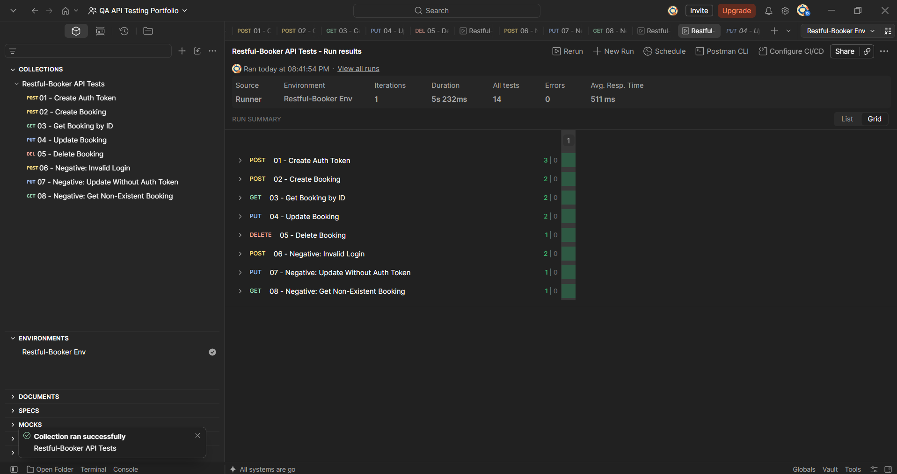

# Restful-Booker API Testing

## Project Overview

This project demonstrates automated REST API testing using Postman and JavaScript. It covers authentication, booking management, positive testing, and negative testing using the Restful-Booker API.

The main objective is to validate API functionality, response accuracy, authentication, and error handling.

## Tools and Technologies

- Postman
- JavaScript
- REST API
- JSON
- Postman Collection Runner
- Git and GitHub

## API Under Test

- API: Restful-Booker
- Base URL: https://restful-booker.herokuapp.com
- API Documentation: https://restful-booker.herokuapp.com/apidoc/

## Test Coverage

| ID | Test Scenario | Method | Expected Status | Test Type |
|---|---|---|---|---|
| 01 | Create Authentication Token | POST | 200 OK | Positive |
| 02 | Create Booking | POST | 200 OK | Positive |
| 03 | Get Booking | GET | 200 OK | Positive |
| 04 | Update Booking | PUT | 200 OK | Positive |
| 05 | Delete Booking | DELETE | 201 Created | Positive |
| 06 | Invalid Authentication | POST | 200 OK | Negative |
| 07 | Update Booking Without Authentication | PUT | 403 Forbidden | Negative |
| 08 | Get Non-Existing Booking | GET | 404 Not Found | Negative |

## Key Testing Features

- HTTP status code validation
- Response body validation
- Response time validation
- Authentication token validation
- Dynamic environment variables
- Request chaining
- CRUD operation testing
- Positive and negative testing
- Automated test execution

## Test Execution Results

| Metric | Result |
|---|---|
| API Requests | 8 |
| Total Automated Tests | 14 |
| Passed Tests | 14 |
| Failed Tests | 0 |
| Errors | 0 |
| Pass Rate | 100% |

All 14 automated test assertions passed successfully during the recorded collection execution.

## Test Execution Screenshot

## Repository Structure

- `Restful-Booker API Tests.postman_collection.json` - Postman test collection
- `Restful_Booker_Env.json` - Postman environment configuration
- `full-collection-list-results.png` - Test execution results
- `README.md` - Project documentation

## How to Run the Project

1. Clone or download this repository.
2. Open Postman.
3. Import the Postman collection JSON file.
4. Import the environment JSON file.
5. Select the Restful-Booker Env environment.
6. Open the Restful-Booker API Tests collection.
7. Click Run Collection.
8. Run the requests and review the automated test results.

## Skills Demonstrated

- API Testing
- Test Case Design
- Test Automation
- Functional Testing
- Authentication Testing
- Negative Testing
- Response Validation
- Environment Variable Management
- Test Execution and Reporting

## Conclusion

This project demonstrates practical knowledge of REST API testing and test automation using Postman, including API validation, authentication, booking operations, and error handling.
